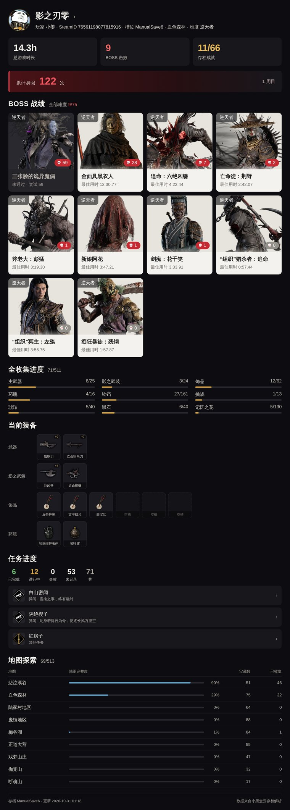

# astrbot_plugin_pbz

> AstrBot 插件：小黑盒扫码登录 + 《影之刃零》生涯数据长图

用小黑盒 App 扫码登录，读取你自己账号下的 Steam 云存档解析结果，生成一张包含 **身陨次数、BOSS 战绩、全收集进度、当前装备、任务进度、地图探索** 的完整战绩长图。

数据全部来自小黑盒，不依赖任何第三方站点。



## 功能

- **扫码登录** —— 小黑盒 App 扫一扫（也可切微信扫码），凭证落盘，重启 AstrBot 后依然有效
- **BOSS 战绩** —— 按小黑盒样式展示：难度标签、死亡次数徽章、最佳用时；**打过但没打赢的 BOSS 也会列出来**，并且排在最前面
- **全收集进度** —— 主武器 / 影之武装 / 饰品 / 药瓶 / 铃铛 / 挑战 / 琥珀 / 黑石 / 记忆之花，共 9 类
- **当前装备** —— 按武器 / 影之武装 / 饰品 / 药瓶分组，带强化等级
- **任务进度** —— 已完成、进行中、失败、未记录的统计 + 进行中的任务卡片
- **地图探索** —— 各地区完成度、宝藏总数、已收集数
- **高清长图** —— 1080px 版面，渲染倍率 1.8×（实际输出 1944px 宽）

## 安装

在 AstrBot 插件市场按仓库地址安装，或手动放进去：

```bash
cd <AstrBot>/data/plugins
git clone https://github.com/syxxjgh/astrbot_plugin_pbz.git
```

依赖只有两个，AstrBot 会自动装：

```
aiohttp>=3.9
qrcode[pil]>=7.4
```

渲染依赖 AstrBot 的 `t2i_endpoint`（内置或自建的 text2img 服务）。如果渲染失败，插件会自动退回文本输出。

## 指令

| 指令 | 权限 | 说明 |
|---|---|---|
| `pbz登录` | 所有人 | 发二维码，用小黑盒 App 扫码，绑定到自己的 QQ |
| `pbz账号` | 所有人 | 昵称、小黑盒 ID、SteamID、好友码、影之刃零入库情况 |
| `pbz战绩` | 所有人 | 生成自己的生涯长图 |
| `pbz战绩 <QQ号>` | 所有人 | 查指定 QQ 的战绩；对方没绑定会提示「查不到战绩」 |
| `pbz战绩 @某人` | 所有人 | 查被 @ 的人的战绩 |
| `pbz帮助` / `pbz help` | 所有人 | 指令一览 |
| `pbz状态` | 所有人 | 当前登录状态与渠道 |
| `pbz退出` | 所有人 | 清除自己的登录凭证 |

**每个 QQ 一份登录态**，存在 `data/plugin_data/astrbot_plugin_pbz/state.json` 的 `accounts` 下，键是 QQ 号。同一个 QQ 在任何群、私聊都共用同一份凭证，扫一次码就够；换个人用就得自己扫一次。

群聊里直接发 `pbz战绩` 就行，不用加前缀；`/pbz战绩` 也认。登录类指令默认**群里也能扫**；不想被抢扫可以在插件配置里关掉。

> AstrBot 的 `filter.command` 受 `wake_prefix` 制约（默认 `/`），群里裸指令本不会触发。插件额外用 `@filter.regex` 兜住了 `pbz战绩` / `pbz账号` / `pbz状态` 的裸文本写法。

## 配置

| 配置项 | 默认 | 说明 |
|---|---|---|
| 登录渠道 | `heybox` | `heybox` 小黑盒 App 扫一扫；`wechat` 微信扫码（最终登录的还是同一个小黑盒账号） |
| 允许在群里扫码登录 | **开启** | 群里也能发二维码；关掉则只能私聊扫码 |
| 扫码等待超时（秒） | 120 | 超时后需重新发送指令 |
| 设备标识 device_id 策略 | `reuse` | `reuse` 复用首次生成的值（官方客户端也是固定值）；`random` 每次换新；`off` 不发 |

## 数据来源

小黑盒 App 里那个「影之刃零」数据页其实是个 H5，挂在
`web.xiaoheihe.cn/game/phantomblade/archive_analysis/home`。插件调用的是它背后的接口：

```
GET /game/cloud_archive/user/accounts?game_id=4115450
    → cur_steam.account_id（SteamID）

GET /game/phantom_blade_zero/archive/list?archive_id=<steamid>&game_id=4115450
    → default_slot_id（默认存档槽）

GET /game/phantom_blade_zero/archive/overview?archive_id=<steamid>&slot_id=<slot>
    → report：身陨 / BOSS / 收集 / 装备 / 地图 / 成就

GET /game/phantom_blade_zero/archive/entries?archive_id=&slot_id=&section=bosses&limit=100
    → 完整 BOSS 名单（overview 只给已击败的那几条）
```

几个踩过的坑，留给出问题时的你：

- `archive/overview` 的 `report.bosses` **只包含已击败的 BOSS**，没打赢的要去 `archive/entries?section=bosses` 拿，那边才是全部 75 个。
- BOSS 卡片上那个数字是 `attempt - kill`，也就是**死在这个 BOSS 手上有几次**，不是尝试次数。
- 请求需要 App 风格的 UA（`ApiMaxJia/1.0`），web 扫码拿到的 `user_pkey` + `user_heybox_id` 可以直接调这些接口。

这些都不是公开 API，小黑盒随时可能改。改版后插件会抛错而不是返回错误数据。

## 账号是怎么存的

```
state.json
└── accounts
    ├── "623611712": { cookies, uid, nickname, device_id, login_at }
    └── "673151930": { ... }
```

- **按 QQ 号索引**，每人一份 cookie，互不可见
- **跨群复用**：同一个 QQ 在 A 群、B 群、私聊用的是同一份凭证，扫码一次即可
- 没有登录的人发 `pbz战绩` 会提示去私聊扫码，不会串到别人的数据
- 旧版本（只有一个全局 `heybox` 键）升级时会自动迁移到首次使用者的 QQ 下

## 常见问题

**二维码扫不出来**
先确认白边够不够（QR 标准要求 4 个模块）。插件已经按标准生成，如果小黑盒仍然识别不了，把「登录渠道」改成 `wechat` 用微信扫——两条路最终登录的是同一个小黑盒账号。

**提示登录已失效**
小黑盒的 `pkey` 有有效期，过期后 `restore_login` 会返回 `status=relogin`。重新发 `pbz登录` 扫码即可，插件会自动清掉旧凭证。

**BOSS 图标 / 用户头像加载不出来**
这些都是外链（`heyboxbj.max-c.com`、`q1.qlogo.cn`），需要 AstrBot 所在环境能访问外网。加载失败时不影响文字和布局。

**群里发 `pbz战绩` 没反应**
先确认机器人确实在那个群、且消息能收到（日志里能看到该群消息）。如果收到但没回复，多半是 `wake_prefix` 导致的：改成 `/pbz战绩` 试试。插件本身已支持裸指令，若仍无响应请检查是不是被别的插件拦截了。

**饰品图标三个一样**
不是插件的 bug。小黑盒给饰品分类配的就是同一张通用图，插件改用「图标 + 名称」的格子来区分。

## 免责声明

- 本项目仅用于查询**自己账号**的游戏数据，不做批量抓取。
- 使用的是小黑盒客户端接口，非公开 API，随时可能失效，请勿用于商业用途。
- 使用本插件造成的账号风控、数据异常等后果由使用者自行承担。

## License

MIT

## 致谢

- [AstrBot](https://github.com/AstrBotDevs/AstrBot) —— 插件框架
- [astrbot_plugin_naraka](https://github.com/as124da1231/astrbot_plugin_naraka) —— 小黑盒扫码登录与 `hkey` 签名实现参考
